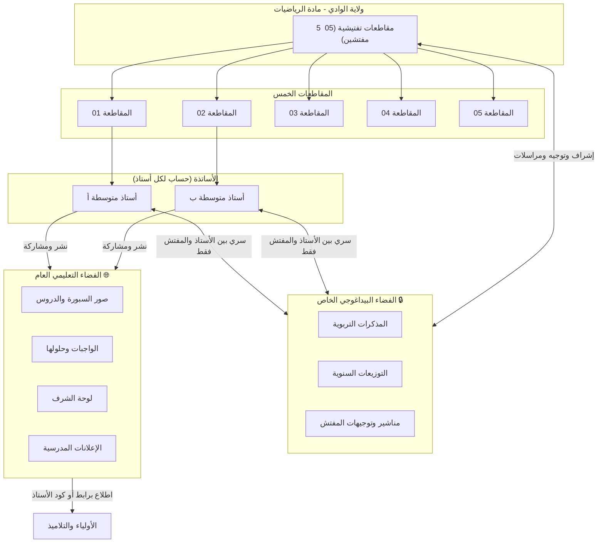

# 📐 المنصة الرقمية الموحدة لمادة الرياضيات — ولاية الوادي
## (فضاء الأستاذ • فضاء المفتش • فضاء الولي والتلميذ)
### وثيقة التحليل وخطة العمل الشاملة (System Architecture & Action Plan)

---

## 🌟 1. الرؤية العامة والأهداف الاستراتيجية

بعد النجاح الميداني للموقع النموذجي واستحسان **مفتش التربية الوطنية لمادة الرياضيات**، تقرر تعميم المبادرة لتصبح **منصة رقمية مركزية وموحدة** لأساتذة مادة الرياضيات في مرحلة التعليم المتوسط بولاية الوادي، تغطي:
- **5 مقاطعات تفتيشية (05)** تتبع لمفتشيات التعليم المتوسط بولاية الوادي.
- مئات المتوسطات عبر دوائر وبلديات الولاية.
- آلاف الأولياء والتلاميذ مع ضمان الخصوصية التامة وسرعة الوصول.

### الأهداف الأساسية:
1. **تمكين كل أستاذ في ولاية الوادي** من امتلاك صفحته وفضائه التعليمي المستقل مجاناً دون الحاجة لأي خبرة تقنية.
2. **تمكين مفتشي المقاطعات الخمس** من الإشراف البيداغوجي المباشر، ومتابعة تدرج الدروس، وفحص المذكرات، وإرسال التعليمات والمناشير الرسمية.
3. **توفير فضاء آمن للولي والتلميذ** للاطلاع على صور السبورة، الواجبات وحلولها، وسلاسل التمارين دون أي تشتت أو اختلاط بأساتذة آخرين.
4. **حماية مطلقة لسرية البيانات (Zero Data Leakage):** عزل تام بين وثائق الأستاذ والمفتش (المذكرات، التوجيهات، التقارير) وبين ما يظهر للجمهور من أولياء وتلاميذ.

---

## 👥 2. هيكلة الأدوار والصلاحيات (Role-Based Access)

---

## 🔑 3. تفصيل صلاحيات كل فضاء

### 1️⃣ فضاء الأستاذ (Teacher Portal)
- **التسجيل الذاتي:** إنشاء حساب جديد عبر البريد أو الهاتف وكلمة مرور.
- **البيانات الوظيفية:** اختيار المقاطعة التفتيشية (1 إلى 5)، اسم المتوسطة، والسنوات التي يدرسها (1، 2، 3، 4 متوسط).
- **كود ورابط فريد:** يحصل كل أستاذ تلقائياً على رابط خاص مثل `math-eloued.dz/t/prof-adaika` وكود سريع مثل `MTH-105` ليشاركه مع تلاميذه وأوليائهم.
- **إدارة المحتوى الصفي:**
  - رفع صور السبورة للدروس مرتبة ومضغوطة تلقائياً.
  - نشر الواجبات المنزلية، السلاسل، وحلولها النموذجية بتنسيق صور أو ملفات PDF.
  - نشر الإعلانات ولوحة الشرف للتلاميذ المتفوقين.
  - تفقد الكراس والسلوك واستدعاءات الأولياء.
- **الفضاء السري مع المفتش (خاص جداً):**
  - رفع بطاقات إعداد الحصص (المذكرات التربوية النموذجية).
  - رفع مخطط التوزيع السنوي وتدرج التعلمات.
  - استقبال الملاحظات البيداغوجية المكتوبة من المفتش على كل مذكرة.
  - استلام المناشير والملفات والتوجيهات المرسلة من مفتش المقاطعة مع إشعار بالاستلام.

---

### 2️⃣ فضاء المفتش (Inspector Portal — 5 مقاطعات)
- **حساب مخصص لكل مفتش مقاطعة:**
  - المقاطعة الأولى (الوادي 1)
  - المقاطعة الثانية (الوادي 2)
  - المقاطعة الثالثة (قمار)
  - المقاطعة الرابعة (الرقيبة)
  - المقاطعة الخامسة (الدبيلة / المقرن)
- **لوحة قيادة تفاعلية للمقاطعة:**
  - عرض قائمة كاملة بمتوسطات المقاطعة وأساتذة الرياضيات المسجلين فيها.
  - معرفة حالة نشاط كل أستاذ (تاريخ آخر درس منشور، عدد الدروس، المذكرات المرفوعة).
  - إمكانية الدخول بضغطة زر لمعاينة ما ينشره الأستاذ لأوليائه وتلاميذه للتأكد من موافقته للمنهاج الرسمي.
- **فحص وتدقيق المذكرات التربوية:**
  - فضاء مخصص لتحميل واستعراض مذكرات أساتذة المقاطعة.
  - إمكانية كتابة ملاحظات تقييمية وتوجيهية لكل أستاذ على مذكرته (تظهر للأستاذ المعني فقط).
- **إرسال المناشير والتوجيهات الولائية:**
  - إرسال تعميم / منشور وزاري أو ولائي لجميع أساتذة المقاطعة دفعة واحدة، أو لمتوسطة محددة، أو لأستاذ بعينه.
  - إرفاق ملفات PDF، وثائق بيداغوجية، نماذج فروض واختبارات تجريبية، أو استدعاءات لندوات تربوية.
  - معرفة من من الأساتذة قرأ المنشور ومن لم يقرأه بعد.

---

### 3️⃣ فضاء الأولياء والتلاميذ (Parent & Student Experience)
- **سهولة فائقة وبدون أي عوائق (بدون تسجيل حساب):** الأولياء والتلاميذ لا يطلب منهم إنشاء حساب أو تذكر كلمات مرور لضمان تفاعل الجميع.
- **طرق الوصول السلس:**
  1. **الرابط المباشر أو الباركود (QR Code):** يطبعه الأستاذ في الكراس أو يرسله في مجموعة أولياء القسم.
  2. **بوابة البحث في الصفحة الرئيسية:** يختار الولي: (المتوسطة) ⬅️ ثم (الأستاذ) ⬅️ فينتقل فوراً لصفحة الأستاذ.
  3. **إدخال كود الأستاذ:** كتابة كود الأستاذ (مثال: `105`) في مربع البحث بالرئيسية.
- **الخصوصية والعزل التام:**
  - الولي يرى **فقط** ما نشره أستاذ ابنه دون أي تداخل مع أساتذة آخرين.
  - حجب تام ومطلق للمذكرات أو المراسلات الإدارية بين الأستاذ والمفتش.

---

## 🛡️ 4. حماية البيانات ومنع التسرب (Security Architecture)

لحماية سمعة المنصة الرسمية لولاية الوادي وتجنب أي تسريب للوثائق التربوية أو بيانات التلاميذ:
1. **الاعتماد على Supabase:**
   - استبدال نظام ملفات JSON القديم بنظام قواعد بيانات متقدم (PostgreSQL).
   - تفعيل **سياسات الحماية على مستوى الصفوف (Row Level Security - RLS)** في قاعدة البيانات، بحيث ترفض قاعدة البيانات برمجياً وبشكل قاطع أي محاولة لقراءة المذكرات من طرف غير مصرح له، حتى لو حاول اختراق واجهة الموقع.
2. **مخازن سحابية منفصلة (Separated Storage Buckets):**
   - **مخزن عام (Public CDN):** لصور السبورة وملفات الدروس والواجبات الموجهة للتلاميذ.
   - **مخزن مشفر وسري (Private Signed URLs):** للمذكرات التربوية والمراسلات بين الأستاذ والمفتش؛ لا يمكن فتح أي رابط إلا عبر توقيع إلكتروني مؤقت مشفر (Signed URL) ينتهي بعد دقائق ويكون متاحاً فقط للأستاذ المعني ومفتش مقاطعته.
3. **تشفير كلمات المرور وجلسات الدخول:** استخدام معايير JWT و HTTP-Only Cookies الحديثة.

---

## 🗺️ 5. مراحل خطة العمل التنفيذية (Phased Execution Plan)

> **حالة التنفيذ (17 أكتوبر 2026):** المراحل 1 إلى 5 منجزة ومختبرة على نسخة Supabase محلية. يبقى من المرحلة 6: اختبار الضغط، دليل الاستخدام المصور، والإطلاق التجريبي الميداني.

### المرحلة الأولى: البنية التحتية وقاعدة البيانات (Infrastructure & Supabase Setup)
- [x] إنشاء مشروع جديد على Supabase مخصص لمنصة ولاية الوادي.
- [x] تطبيق مخطط قاعدة البيانات (`wilaya_schema.sql`):
  - جدول المقاطعات التفتيشية الخمس (`districts`).
  - جدول المتوسطات التابعة للولاية (`middle_schools`).
  - جدول الملفات الشخصية والحسابات (`profiles`).
  - جداول الدروس، الصور، الواجبات، الإعلانات، لوحات الشرف.
  - جداول المذكرات التربوية السرية (`pedagogical_notes`).
  - جداول المناشير والمراسلات التوجيهية للمفتش (`inspector_circulars`).
- [x] تهيئة مخازن الملفات السحابية (Storage Buckets) وسياسات الأمان (RLS Policies).

### المرحلة الثانية: نظام التسجيل والمصادقة متعدد الأدوار (Auth & Multi-Tenancy)
- [x] واجهة تسجيل أستاذ جديد مع اختيار المقاطعة والمتوسطة وتوليد الكود/الرابط الخاص.
- [x] واجهة تسجيل دخول الأساتذة والمفتشين مع توجيه ذكي حسب الدور (`teacher` ⬅️ لوحة الأستاذ ، `inspector` ⬅️ لوحة المفتش).
- [x] حسابات المفتشين الخمسة الافتراضية مع تأمين صلاحيات مقاطعة كل مفتش.

### المرحلة الثالثة: ترقية فضاء الأستاذ وإضافة قسم المذكرات السرية (Teacher Workspace)
- [x] ربط نظام إدارة الدروس والسبورة الحالي بقاعدة بيانات Supabase بدلاً من Vercel Blob.
- [x] بناء قسم جديد: **"الملف البيداغوجي والمذكرات" (خاص بالمفتش)** داخل لوحة الأستاذ.
- [x] تفعيل نظام رفع المذكرات مع وسوم للمستوى، الفصل، والوحدة التعليمية، مع إشعار للمفتش.
- [x] صندوق بريد الأستاذ لاستقبال توجيهات ومناشير مفتش المقاطعة.

### المرحلة الرابعة: بناء لوحة تحكم المفتش (Inspector Dashboard)
- [x] صفحة رئيسية تعرض ملخص المقاطعة: المتوسطات، عدد الأساتذة، الدروس المنشورة، ونسبة رفع المذكرات.
- [x] صفحة استعراض أساتذة المقاطعة مع إمكانية الدخول لمعاينة دروسهم الموجهة للتلاميذ.
- [x] قسم فحص المذكرات: مطالعة المذكرة، كتابة التوجيهات البيداغوجية، وإرسالها للأستاذ.
- [x] أداة إرسال المناشير والتعميمات: إرسال منشور أو ملف لجميع أساتذة المقاطعة أو لمتوسطة محددة وتتبع من اطلع عليه.

### المرحلة الخامسة: بوابة الأولياء والتلاميذ التفاعلية (Public Discovery Portal)
- [x] صفحة رئيسية جديدة للمنصة ترحب بزوار ولاية الوادي.
- [x] محرك بحث ذكي وسريع: اختيار المتوسطة ⬅️ اختيار الأستاذ ⬅️ فتح فضاء الأستاذ المخصص.
- [x] دعم الروابط المختصرة (Dynamic Routing: `/t/[teacherSlug]`).
- [x] دعم وضع عدم الاتصال (PWA Offline) لحفظ الدروس وتصفحها بدون إنترنت في المناطق ضعيفة التغطية.

### المرحلة السادسة: التدقيق الأمني، الاختبار الميداني، والإطلاق (Testing & Launch)
- [x] اختبار أمان RLS ومنع تسرب البيانات والتأكد من استحالة وصول الأولياء للمذكرات.
- [ ] اختبار ضغط الرفع المتزامن للصور والمذكرات.
- [ ] تجهيز دليل استخدام مبسط للأستاذ والمفتش (PDF وشروحات مصورة).
- [ ] إطلاق النسخة التجريبية على نطاق عينة من أساتذة المقاطعة الأولى مع المفتش قبل التعميم الكامل.
